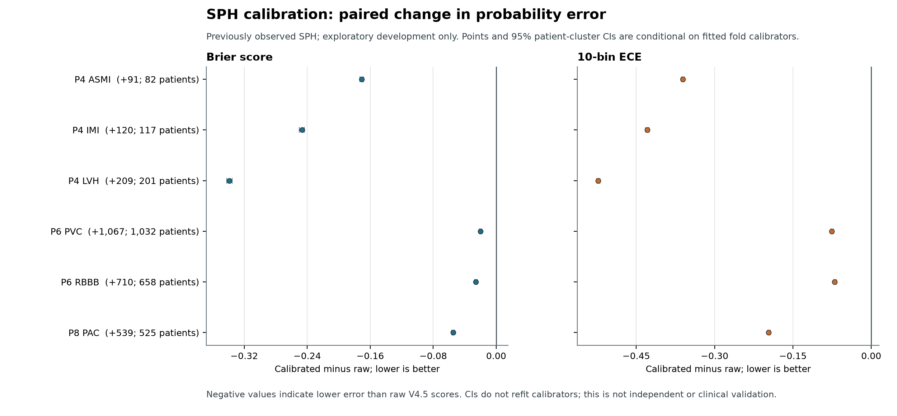

# B1 SPH Calibration Results

**Status:** completed exploratory V4.6 adaptation diagnostic. This is not an
independent, confirmatory, or clinical validation. SPH had already been
observed in the V4.5 transfer analysis. No weights, labels, frozen V4.5
thresholds, historical results, or manuscript files were changed.

## Scope And Method

The run processed 25,770 ECG records from 24,666 patients and evaluated six
endpoints with complete frozen-score and ECG-statement-code mappings. A
positive is presence of the specified code on an ECG. Code absence is not a
clinically adjudicated disease-negative result; AF onset, acute MI, imaging
confirmation, and beat-level PAC/PVC detection are not evaluated here.

Each endpoint used five deterministic patient-grouped outer folds. Within each
fold, the remaining patients were split into calibrator-fit and separate
threshold-tuning groups (approximately 60% / 20% / 20% of all patients for fit,
tune, and out-of-fold evaluation). Positive-slope Platt scaling was fitted to
the frozen V4.5 probability logits. Raw and Platt F1 thresholds were selected
separately on the tune patients, then applied to the held-out fold. The report
also includes Platt-at-0.5 as a descriptive reference, not a clinical cutoff.
The paired 2,000-replicate bootstrap resampled patient clusters on pooled
out-of-fold predictions; it did not refit fold calibrators.

## Operating And Ranking Metrics

The saved V4.5-label F1 column is a separate descriptive baseline using the
published decisions (including the existing P8 fallback where applicable).
It is not the nested-CV F1 and is not a replacement for the canonical V4.5
metrics.

| Endpoint | ECG code+ (patients) | Saved V4.5-label F1 | Nested raw F1 | Nested Platt F1 | AUROC raw -> Platt | Average precision raw -> Platt |
|---|---:|---:|---:|---:|---:|---:|
| P4 ASMI | 91 (82) | 0.0473 | 0.0699 | 0.0699 | 0.8762 -> 0.8731 | 0.0526 -> 0.0510 |
| P4 IMI | 120 (117) | 0.0325 | 0.2427 | 0.2427 | 0.9088 -> 0.9053 | 0.1435 -> 0.1422 |
| P4 LVH | 209 (201) | 0.0365 | 0.1241 | 0.1241 | 0.7943 -> 0.7938 | 0.0503 -> 0.0494 |
| P6 PVC | 1,067 (1,032) | 0.5408 | 0.6519 | 0.6519 | 0.9562 -> 0.9561 | 0.6539 -> 0.6518 |
| P6 RBBB | 710 (658) | 0.5570 | 0.7444 | 0.7444 | 0.9875 -> 0.9874 | 0.8064 -> 0.8058 |
| P8 PAC | 539 (525) | 0.2650 | 0.3730 | 0.3730 | 0.8496 -> 0.8493 | 0.2895 -> 0.2887 |

Raw and Platt nested-CV F1 are identical for every endpoint; their paired
bootstrap differences are exactly zero in the machine-readable output. This
does not show a classification improvement. A monotone score transformation
with a separately F1-optimized threshold can preserve the same binary
decisions.

At the separately tuned operating point, the predictions are identical before
and after Platt scaling. The following counts therefore apply to both score
representations and are not evidence of improved classification:

| Endpoint | TP | FP | FN | TN | Sensitivity | PPV |
|---|---:|---:|---:|---:|---:|---:|
| P4 ASMI | 13 | 268 | 78 | 25,411 | 0.1429 | 0.0463 |
| P4 IMI | 25 | 61 | 95 | 25,589 | 0.2083 | 0.2907 |
| P4 LVH | 26 | 184 | 183 | 25,377 | 0.1244 | 0.1238 |
| P6 PVC | 763 | 511 | 304 | 24,192 | 0.7151 | 0.5989 |
| P6 RBBB | 530 | 184 | 180 | 24,876 | 0.7465 | 0.7423 |
| P8 PAC | 224 | 438 | 315 | 24,793 | 0.4156 | 0.3384 |

The aggregate JSON records every outer-fold fit, threshold-tune, and evaluation
denominator, including positive ECG records and positive patients. P4 support
is particularly sparse: ASMI has 15-20 positive patients in each threshold
tuning fold and 13-20 in each evaluation fold; IMI has 15-22 and 21-26,
respectively. These supports make per-fold estimates unstable and should
remain visible in any downstream report.

Ranking-metric changes use the same paired patient-cluster bootstrap. Negative
values mean the Platt score ranked examples slightly worse than the raw score.
These intervals are conditional on fitted fold calibrators and have no
multiple-comparison adjustment:

| Endpoint | Delta AUROC (95% CI) | Delta average precision (95% CI) |
|---|---:|---:|
| P4 ASMI | -0.003118 [-0.007007, 0.000762] | -0.001608 [-0.005602, 0.001035] |
| P4 IMI | -0.003509 [-0.006462, -0.000912] | -0.001232 [-0.007786, 0.006363] |
| P4 LVH | -0.000446 [-0.001268, 0.000381] | -0.000954 [-0.003782, 0.000447] |
| P6 PVC | -0.000154 [-0.000246, -0.000061] | -0.002035 [-0.003184, -0.000885] |
| P6 RBBB | -0.000099 [-0.000229, 0.000010] | -0.000542 [-0.002088, 0.001008] |
| P8 PAC | -0.000354 [-0.000752, 0.000058] | -0.000856 [-0.003009, 0.001544] |

## Probability Error

Values below are raw -> Platt, followed by the paired calibrated-minus-raw
difference and 95% patient-cluster interval. Negative differences mean lower
error than the raw V4.5 probabilities.

| Endpoint | Brier raw -> Platt | Delta Brier (95% CI) | ECE raw -> Platt | Delta ECE (95% CI) |
|---|---:|---:|---:|---:|
| P4 ASMI | 0.1745 -> 0.0036 | -0.1709 [-0.1733, -0.1686] | 0.3615 -> 0.0006 | -0.3609 [-0.3635, -0.3579] |
| P4 IMI | 0.2510 -> 0.0043 | -0.2467 [-0.2501, -0.2436] | 0.4295 -> 0.0006 | -0.4289 [-0.4320, -0.4257] |
| P4 LVH | 0.3466 -> 0.0079 | -0.3388 [-0.3423, -0.3352] | 0.5235 -> 0.0005 | -0.5230 [-0.5260, -0.5194] |
| P6 PVC | 0.0410 -> 0.0210 | -0.0201 [-0.0214, -0.0188] | 0.0791 -> 0.0037 | -0.0754 [-0.0774, -0.0724] |
| P6 RBBB | 0.0357 -> 0.0099 | -0.0258 [-0.0273, -0.0243] | 0.0711 -> 0.0010 | -0.0701 [-0.0714, -0.0669] |
| P8 PAC | 0.0723 -> 0.0175 | -0.0548 [-0.0563, -0.0532] | 0.1992 -> 0.0029 | -0.1963 [-0.1980, -0.1933] |



[PDF figure](../../outputs/figures/benchmarkmax/sph_b1_calibration_deltas.pdf).

These are improvements relative to the raw scores only. B1 did not include a
constant-prevalence probability comparator, and the intervals condition on the
fitted fold calibrators rather than refitting them. The large Brier/ECE changes
therefore do not establish incremental value over a prevalence-only predictor,
transfer to another institution, or clinical usefulness. The held-out folds
are patient-disjoint within this analysis, but SPH itself is not a new or
untouched external cohort. No clinical threshold is proposed.

## Execution And Provenance

- CEDIA SLURM job `32758`: `COMPLETED`, exit code `0`, `cpu-dev`, 2 CPUs, 8 GB, elapsed `00:03:11`.
- Runtime: existing CEDIA `miniconda3/3` environment `yc_env2`, Python `3.10.18`, NumPy `1.26.4`, SciPy `1.15.3`.
- Public execution commit: [`d65c6ed`](https://github.com/Mateo197802/titan-v45-ecg-multihead/commit/d65c6ed78cd27626de50ec12e3b7c649e472440b), in [draft PR #5](https://github.com/Mateo197802/titan-v45-ecg-multihead/pull/5). Its CI run [42586893534](https://github.com/Mateo197802/titan-v45-ecg-multihead/actions/runs/42586893534) passed on Python 3.10, 3.11, and 3.12.
- CEDIA delivery commit: `62cff27a16f621d564a22bd3a50259a7b2d79745`; Git tree `79bce5b4ac94e5490b507d3b7e62e8b26fe897aa`, identical to the public execution commit's tree. CEDIA's local commit ID differs because the patch was applied onto its delivery history.
- Aggregate result: [`sph_b1_calibration_32758.json`](../../outputs/results/benchmarkmax/sph_b1_calibration_32758.json), SHA-256 `859b99a3208442a791badcbd9996001678e815b00d01194f9d521926feeb2272`, 70,051 bytes. It contains aggregate metrics, fold supports, thresholds, Platt parameters, CIs, and execution hashes only; no signals, ECG/patient IDs, or row-level predictions.
- B1 configuration SHA-256: `3e00a03b2376f1935ea5d2fb1197aae41e1884f17119f8291ed351d7a1d3d5ad`.
- Calibrator SHA-256: `320621cdeb91d8d7abef2949a9ac41e49ce6d8bd277b66bd5836e40cb6720406`.
- SLURM wrapper SHA-256: `6b64ad75f7340f02682cc762bc5aa671cb95a88c403b6d6cae0489bcb299536c`.
- PNG SHA-256: `5454d855fb95f4c97ec1a4f508d1ae231e4a55b392c05361d9f9778a4c252d54`. PDF SHA-256: `3878fa1c6468574d84f87f53324bccc25edfc3c6cd2c4daa32d45ef622105de2`.
- Figure inventory: [`sph_b1_calibration_figure_manifest.json`](../../outputs/figures/benchmarkmax/sph_b1_calibration_figure_manifest.json), SHA-256 `520bc68bf867359b4cdfcce9e7e62373fb9d6ead7811664b7a434eb15f98fea8`; it binds both rendered files to this aggregate and the renderer source.
- Frozen input SHA-256 values: SPH metadata `c6f8dc5197758a3970aae554f8b6ee884d96656b121879bc0eb1adf367ea6d86`; prediction ledger `4a3a1e61b1784e06190d5caaa089fca04ef84792acb3a5f9fc1af3f9c1173462`; V4.5 protocol config `d788ad8cca94793cebb738496acc131e82b1ca1900976f11020b99a79a5fc366`; scoring receipt `8abdc5f6561fc3fea77eeb68e8aa34bc2d02396cad9c2e9fbeea70b4188dac92`; baseline aggregate `50487cd92a91924a0aa63549725eb26d9328f307a6a6d9cf57ac2655e85ad2ef`.
- Attempt `32757` ended before parsing labels or calculating B1 metrics: the runner initially looked for bootstrap settings at the wrong JSON path. It created no result artifact. The schema handling was corrected before successful job `32758`; the failed attempt is retained in CEDIA logs.

Revalidate the sanitized receipt and reproduce the figure from the aggregate-only file:

```powershell
python scripts/benchmarkmax/verify_sph_b1_aggregate.py `
  --report outputs/results/benchmarkmax/sph_b1_calibration_32758.json `
  --config configs/benchmarkmax/sph_b1_calibration.json `
  --calibrator scripts/benchmarkmax/calibrate_sph_frozen_scores.py `
  --expected-job-id 32758

python scripts/benchmarkmax/render_sph_b1_figure.py `
  --report outputs/results/benchmarkmax/sph_b1_calibration_32758.json `
  --output outputs/figures/benchmarkmax/sph_b1_calibration_deltas.png

python scripts/benchmarkmax/render_sph_b1_figure.py `
  --report outputs/results/benchmarkmax/sph_b1_calibration_32758.json `
  --output outputs/figures/benchmarkmax/sph_b1_calibration_deltas.pdf
```

The aggregate verifier checks the frozen input/configuration and runner hashes,
privacy flags and forbidden row-level keys, complete cohort and fold
denominators, confusion-derived supports/metrics, disjoint patient partitions,
bootstrap replicate totals, and consistency of reported point deltas with the
raw and calibrated metrics. Focused verifier and renderer tests are in
`tests/evaluation/test_verify_sph_b1_aggregate.py`.

The full CEDIA input paths and submission wrapper are described in
[`B1_SPH_CALIBRATION_PROTOCOL.md`](B1_SPH_CALIBRATION_PROTOCOL.md). The private
ledger and metadata remain in CEDIA. This V4.6 diagnostic does not close any
V4.5 reviewer observation, change the 48-point reviewer matrix, or modify the
manuscript. Independent external evaluation remains deferred.
