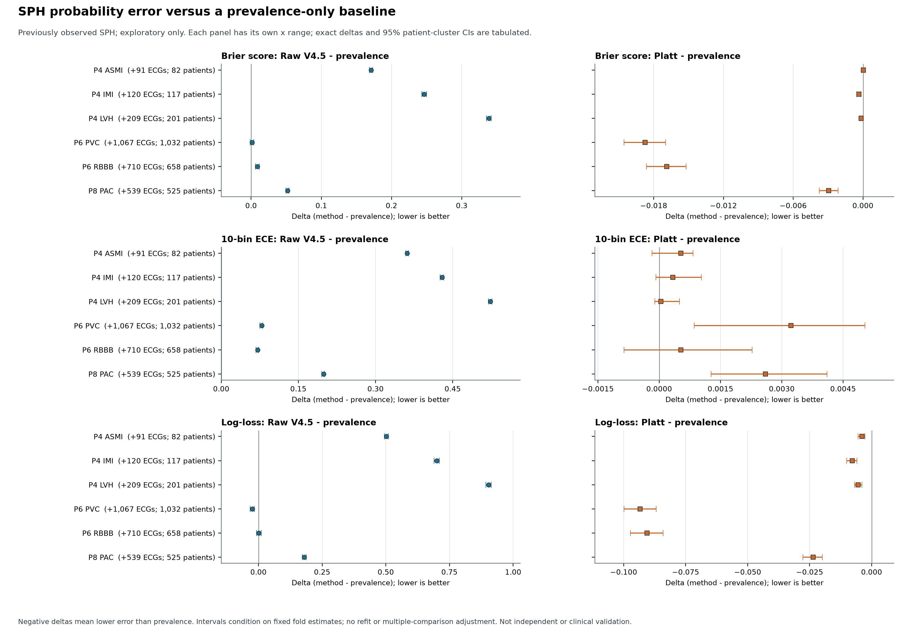

# B1 SPH Prevalence Comparator Results

**Status:** completed aggregate-only exploratory analysis; not independent,
external, or clinical validation. This is a standalone technical evidence
record, not manuscript text. No manuscript, V4.5 model
weights, labels, thresholds, or historical results were changed.

## Question And Scope

This analysis compares the saved raw V4.5 probabilities and B1 positive-slope
Platt out-of-fold probabilities with a constant endpoint-prevalence probability.
For each existing patient-grouped outer fold, the prevalence is fitted using
only B1 `calibration_fit` patients outside that fold, the same fitting role used
by Platt. No outer-evaluation labels or threshold-tuning patients contribute to
the constant estimate. No threshold or classification decision is assigned to
the prevalence baseline.

The outcome is presence of the frozen ECG statement code on an ECG record.
Code absence is not a clinically adjudicated disease-negative reference.
PAC/PVC are record-level statements, not beat-event detection; the MI and LVH
labels are not acute/clinically adjudicated MI or imaging-confirmed LVH.

The population contains 25,770 ECG records from 24,666 patients. All SPH
records/outcomes had already been observed in V4.5 transfer work. Therefore,
these are development/adaptation results, not independent external or clinical
validation. They do not answer the deferred independent-cohort evaluation.

## Endpoint Support

| Endpoint | Positive ECG statements | Negative ECG statements | Patients with positive statements |
|---|---:|---:|---:|
| P4 ASMI | 91 | 25,679 | 82 |
| P4 IMI | 120 | 25,650 | 117 |
| P4 LVH | 209 | 25,561 | 201 |
| P6 PVC | 1,067 | 24,703 | 1,032 |
| P6 RBBB | 710 | 25,060 | 658 |
| P8 PAC | 539 | 25,231 | 525 |

The shared denominator is 25,770 ECGs / 24,666 patients for every endpoint.
Positive-patient counts are not independent of positive ECG counts because one
patient may contribute repeated ECGs.

## Metrics

Brier is mean squared probability error; 10-bin ECE is equal-width expected
calibration error; log-loss is binary log-loss. For each probability metric,
the tables show raw, cross-fitted prevalence, and Platt values, then paired
`method - prevalence` point differences with 95% patient-cluster bootstrap
intervals. Negative deltas favor the method being compared. Intervals use 2,000
paired, unstratified patient-cluster bootstrap replicates and are conditional on
the fitted fold-specific Platt and prevalence estimates; neither is refitted
inside bootstrap replicates. There is no multiple-comparison adjustment.

### Brier Score

| Endpoint | Raw | Prevalence | Platt | Raw - prevalence (95% CI) | Platt - prevalence (95% CI) |
|---|---:|---:|---:|---:|---:|
| P4 ASMI | 0.174476 | 0.003519 | 0.003560 | +0.170956 [+0.168580, +0.173428] | +0.000040 [-0.000102, +0.000180] |
| P4 IMI | 0.250991 | 0.004635 | 0.004291 | +0.246356 [+0.242998, +0.249843] | -0.000344 [-0.000543, -0.000171] |
| P4 LVH | 0.346648 | 0.008045 | 0.007891 | +0.338603 [+0.335078, +0.342121] | -0.000154 [-0.000241, -0.000071] |
| P6 PVC | 0.041029 | 0.039693 | 0.020963 | +0.001335 [-0.001309, +0.003878] | -0.018731 [-0.020562, -0.016975] |
| P6 RBBB | 0.035680 | 0.026797 | 0.009907 | +0.008883 [+0.006329, +0.011584] | -0.016890 [-0.018632, -0.015221] |
| P8 PAC | 0.072325 | 0.020479 | 0.017540 | +0.051846 [+0.049811, +0.053841] | -0.002939 [-0.003750, -0.002146] |

### 10-Bin ECE

| Endpoint | Raw | Prevalence | Platt | Raw - prevalence (95% CI) | Platt - prevalence (95% CI) |
|---|---:|---:|---:|---:|---:|
| P4 ASMI | 0.361489 | 0.000032 | 0.000561 | +0.361457 [+0.358505, +0.363978] | +0.000530 [-0.000173, +0.000831] |
| P4 IMI | 0.429511 | 0.000310 | 0.000642 | +0.429202 [+0.425780, +0.432428] | +0.000333 [-0.000079, +0.001035] |
| P4 LVH | 0.523501 | 0.000422 | 0.000466 | +0.523078 [+0.519596, +0.526222] | +0.000044 [-0.000107, +0.000493] |
| P6 PVC | 0.079116 | 0.000477 | 0.003701 | +0.078639 [+0.075354, +0.080637] | +0.003225 [+0.000859, +0.005037] |
| P6 RBBB | 0.071063 | 0.000455 | 0.000983 | +0.070608 [+0.067379, +0.072580] | +0.000528 [-0.000863, +0.002272] |
| P8 PAC | 0.199224 | 0.000283 | 0.002882 | +0.198941 [+0.195448, +0.200847] | +0.002599 [+0.001267, +0.004109] |

### Log-Loss

| Endpoint | Raw | Prevalence | Platt | Raw - prevalence (95% CI) | Platt - prevalence (95% CI) |
|---|---:|---:|---:|---:|---:|
| P4 ASMI | 0.525862 | 0.023556 | 0.019616 | +0.502307 [+0.494655, +0.509614] | -0.003940 [-0.005477, -0.002659] |
| P4 IMI | 0.729391 | 0.029669 | 0.021800 | +0.699723 [+0.689443, +0.710091] | -0.007868 [-0.010072, -0.005952] |
| P4 LVH | 0.950675 | 0.047159 | 0.041703 | +0.903517 [+0.893124, +0.914187] | -0.005455 [-0.006969, -0.003945] |
| P6 PVC | 0.148277 | 0.172422 | 0.079049 | -0.024145 [-0.032603, -0.015806] | -0.093372 [-0.099893, -0.086842] |
| P6 RBBB | 0.127777 | 0.126212 | 0.035675 | +0.001565 [-0.007581, +0.010964] | -0.090537 [-0.097266, -0.084110] |
| P8 PAC | 0.281757 | 0.101607 | 0.077996 | +0.180150 [+0.172362, +0.187573] | -0.023611 [-0.027730, -0.019928] |



[PDF figure](../../outputs/figures/benchmarkmax/sph_b1_prevalence_comparison.pdf) ·
[figure manifest](../../outputs/figures/benchmarkmax/sph_b1_prevalence_figure_manifest.json).

## Interpretation

- Raw V4.5 probabilities have higher ECE than the prevalence baseline for all
  six endpoints. Raw Brier is also higher except that the P6 PVC interval
  includes zero. Raw log-loss is lower for P6 PVC, higher for four endpoints,
  and inconclusive for P6 RBBB.
- Platt probabilities have lower log-loss than prevalence for all six
  endpoints. Platt Brier is lower for five endpoints; P4 ASMI's interval
  includes zero. Platt ECE is higher for P6 PVC and P8 PAC, while the other four
  intervals include zero. Thus, Platt does not dominate the comparator on
  every probability metric.
- These comparisons concern probability-error summaries on ECG statement
  labels. They do not establish diagnostic accuracy, clinical utility, a
  deployment threshold, or generalization to an independent institution.

## Execution And Provenance

- CEDIA SLURM job `32763`: `COMPLETED`, exit `0:0`, CPU partition `cpu-dev`,
  elapsed `00:03:08`; Python `3.10.18`, NumPy `1.26.4`, SciPy `1.15.3`.
- Frozen execution commit: [`bf5aab0`](https://github.com/Mateo197802/titan-v45-ecg-multihead/commit/bf5aab0264610235e79cda786e64c524637606ff),
  in [draft PR #5](https://github.com/Mateo197802/titan-v45-ecg-multihead/pull/5).
  CI run [42607448187](https://github.com/Mateo197802/titan-v45-ecg-multihead/actions/runs/42607448187)
  passed on Python 3.10, 3.11 and 3.12.
- Aggregate receipt:
  [`sph_b1_prevalence_comparison_32763.json`](../../outputs/results/benchmarkmax/sph_b1_prevalence_comparison_32763.json),
  SHA-256 `b7c5b29743fc6710ba486bb6e393a01ba216db9598ad5b74995ad6cedb0cf530`,
  40,689 bytes. The CEDIA copy was mode `0600`; the published file contains
  aggregate metrics and supports only, not ECG/patient IDs, row-level scores,
  or signals.
- Comparator configuration SHA-256:
  `06db047ca88018790ef03e8c88f40b918e320c85394e752a5a9effb8e3a3ee2c`.
- Comparator runner SHA-256:
  `84785f099dd35548055c48e6efb27807ea4793725e1649fea865906183496e2d`.
- Aggregate verifier SHA-256:
  `53c7ae634c6fff4af4ca7e5fcb4246de6899973c42e7a222a1fdab4849747371`.
- Frozen protocol SHA-256:
  `6fb2eaf4e7ac1079a563b86dca98e1a46c187807234cfe3ade9ce3c77186ec7d`.
- Input hashes: metadata `c6f8dc5197758a3970aae554f8b6ee884d96656b121879bc0eb1adf367ea6d86`;
  prediction ledger `4a3a1e61b1784e06190d5caaa089fca04ef84792acb3a5f9fc1af3f9c1173462`;
  V4.5 frozen config `d788ad8cca94793cebb738496acc131e82b1ca1900976f11020b99a79a5fc366`;
  scoring receipt `8abdc5f6561fc3fea77eeb68e8aa34bc2d02396cad9c2e9fbeea70b4188dac92`;
  normalized baseline aggregate `50487cd92a91924a0aa63549725eb26d9328f307a6a6d9cf57ac2655e85ad2ef`;
  B1 calibration config `3e00a03b2376f1935ea5d2fb1197aae41e1884f17119f8291ed351d7a1d3d5ad`;
  B1 calibration runner `320621cdeb91d8d7abef2949a9ac41e49ce6d8bd277b66bd5836e40cb6720406`;
  B1 calibration aggregate `859b99a3208442a791badcbd9996001678e815b00d01194f9d521926feeb2272`.

Recheck the published aggregate against its frozen code/configuration and
registry entry:

```bash
python scripts/benchmarkmax/verify_sph_prevalence_comparison.py \
  --report outputs/results/benchmarkmax/sph_b1_prevalence_comparison_32763.json \
  --config configs/benchmarkmax/sph_b1_prevalence_comparison.json \
  --runner scripts/benchmarkmax/compare_sph_prevalence_baseline.py \
  --registry docs/benchmarkmax/BENCHMARKMAX_EXPERIMENT_REGISTRY.json \
  --expected-job-id 32763
```

The external evaluation remains deferred. MIMIC-IV-ECG v1.0 is openly
downloadable subject to ODbL, but it has not been downloaded, inspected or
reserved here and its report lines are machine-generated, not adjudicated
clinical references. Author access to credentialed MIMIC-IV-ECG-Ext-ICD is not
confirmed. No MIMIC data were accessed. This result does not close any V4.5
reviewer point that requires an untouched external cohort.
