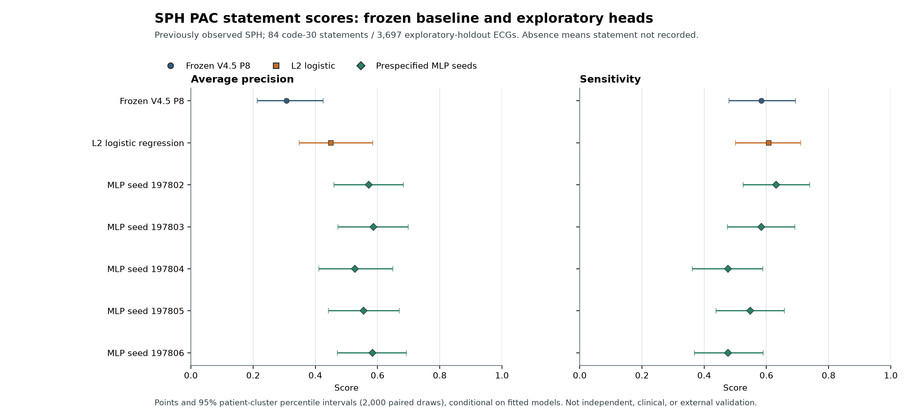

# SPH PAC Head Comparison: Exploratory Results

## Executive Summary

- The frozen V4.5 P8 comparator, one L2 logistic head, and all five prespecified V4.6 MLP seeds were evaluated on the same 3,697-record patient-grouped SPH exploratory holdout, containing 84 code-30 statements. All 2,000 patient-cluster bootstrap replicates were valid for each paired comparison.
- Every new head had higher average precision than frozen P8 on this split. The nominal paired AP difference was `+0.143` (`95% CI 0.044 to 0.250`) for logistic and `+0.220` to `+0.280` for the MLP seeds versus P8. Four of five MLP-versus-logistic AP intervals excluded zero; this is exploratory and unadjusted for the multiple seed comparisons.
- Sensitivity is not uniformly better: MLP seeds `197804` and `197806` had `0.476` sensitivity versus `0.607` for logistic, with paired sensitivity differences of `-0.131` and nominal intervals below zero. No seed is selected as a winner.
- These are predictions of whether an ECG record contains an SPH code-30 statement, not adjudicated PAC disease, incident AF/PAC, beat detection, clinical utility, or independent external validation. SPH was previously observed in the project; this run does not close the external-evaluation requirement.

## Result Figure



The intervals are 95% paired patient-cluster percentile-bootstrap intervals with 2,000 draws, conditional on the fitted models. They do not represent between-source uncertainty or model-selection uncertainty.

## Population and Endpoint

| Stage | ECG records | Patients | Code-30 positive records |
|---|---:|---:|---:|
| Frozen SPH source inventory | 25,770 | 24,666 | 539 before signal exclusions |
| Train partition after technical/deduplication exclusions | 17,916 | 17,265 | 361 |
| Development partition | 3,821 | 3,686 | 87 |
| Exploratory holdout | 3,697 | 3,558 | 84 |
| Total eligible for the three partitions | 25,434 | 24,509 across partitions | 532 |

The dictionary defines code `30` as “Atrial premature complex(es).” Code `31` (“Atrial premature complexes, nonconducted”) remains separate: four source records had code 31 before signal exclusions; among eligible records, one co-recorded code 30 and three did not. Code-30 absence means **statement not recorded**, not a verified disease-negative reference. The holdout has 84 code-30 statements and 3,613 records without code 30 (2.27% positive statement prevalence).

The waveform archive contained 25,770 technically valid signals. The run excluded all 336 records participating in 168 exact duplicate-signal groups before joining labels. Near-duplicate signals and duplicates against other datasets were not tested. All 25,434 remaining records had V4.5 P8 PAC scores available. There were no cross-patient overlaps among train, development and holdout partitions. Partition assignment used the frozen patient-hash rule and did not use labels.

The source HDF5 metadata does not establish physical mV units. The pipeline therefore applied finite-value/non-flat technical checks and no amplitude cutoff; reported signal-amplitude summaries remain in unitless source units. The run processed 34,200 10-second windows from 25,434 eligible records.

## Holdout Metrics

All models use the same denominator (`n=3,697`, 84 statement-positive and 3,613 statement-not-recorded). The frozen P8 comparator uses its original threshold `0.45`. New-head thresholds maximize F1 only on the development partition; they are engineering thresholds, not clinical decision thresholds. MLP seeds were all reported as prespecified; none was selected post hoc.

### Threshold Metrics

Confusion counts are `TP / FP / TN / FN`.

| Model | Threshold | TP / FP / TN / FN | Sensitivity | Specificity | PPV | F1 | MLP epochs |
|---|---:|---:|---:|---:|---:|---:|---:|
| Frozen V4.5 P8 PAC | 0.450000 | 49 / 230 / 3,383 / 35 | 0.583 | 0.936 | 0.176 | 0.270 | n/a |
| L2 logistic regression | 0.110618 | 51 / 85 / 3,528 / 33 | 0.607 | 0.976 | 0.375 | 0.464 | n/a |
| MLP seed 197802 | 0.249826 | 53 / 48 / 3,565 / 31 | 0.631 | 0.987 | 0.525 | 0.573 | 33 |
| MLP seed 197803 | 0.315933 | 49 / 35 / 3,578 / 35 | 0.583 | 0.990 | 0.583 | 0.583 | 46 |
| MLP seed 197804 | 0.199605 | 40 / 29 / 3,584 / 44 | 0.476 | 0.992 | 0.580 | 0.523 | 53 |
| MLP seed 197805 | 0.253838 | 46 / 34 / 3,579 / 38 | 0.548 | 0.991 | 0.575 | 0.561 | 36 |
| MLP seed 197806 | 0.412093 | 40 / 24 / 3,589 / 44 | 0.476 | 0.993 | 0.625 | 0.541 | 36 |

### Probability Metrics

| Model | AUROC | Average precision | Brier | 10-bin ECE |
|---|---:|---:|---:|---:|
| Frozen V4.5 P8 PAC | 0.853 | 0.307 | 0.07333 | 0.19931 |
| L2 logistic regression | 0.927 | 0.450 | 0.01630 | 0.01026 |
| MLP seed 197802 | 0.942 | 0.571 | 0.01398 | 0.00312 |
| MLP seed 197803 | 0.944 | 0.587 | 0.01356 | 0.00617 |
| MLP seed 197804 | 0.935 | 0.527 | 0.01485 | 0.01026 |
| MLP seed 197805 | 0.941 | 0.555 | 0.01406 | 0.00652 |
| MLP seed 197806 | 0.946 | 0.584 | 0.01394 | 0.00513 |

### Paired Comparisons

Differences below are candidate minus reference. Negative Brier/ECE differences favor the candidate because lower is better. Intervals are nominal 95% paired patient-cluster percentile-bootstrap intervals (2,000 replicates, NumPy PCG64 seed `197813`); there is no multiple-comparison correction.

| Comparison | AP difference (95% CI) | Sensitivity difference (95% CI) | Specificity difference (95% CI) |
|---|---:|---:|---:|
| Logistic minus frozen P8 | +0.143 (+0.044, +0.250) | +0.024 (-0.049, +0.100) | +0.040 (+0.032, +0.049) |
| MLP 197802 minus frozen P8 | +0.264 (+0.171, +0.349) | +0.048 (-0.045, +0.145) | +0.050 (+0.043, +0.059) |
| MLP 197803 minus frozen P8 | +0.280 (+0.178, +0.370) | +0.000 (-0.080, +0.089) | +0.054 (+0.047, +0.062) |
| MLP 197804 minus frozen P8 | +0.220 (+0.123, +0.313) | -0.107 (-0.200, -0.013) | +0.056 (+0.048, +0.064) |
| MLP 197805 minus frozen P8 | +0.248 (+0.158, +0.334) | -0.036 (-0.106, +0.035) | +0.054 (+0.047, +0.062) |
| MLP 197806 minus frozen P8 | +0.277 (+0.188, +0.357) | -0.107 (-0.197, -0.024) | +0.057 (+0.049, +0.065) |
| MLP 197802 minus logistic | +0.121 (+0.038, +0.184) | +0.024 (-0.057, +0.106) | +0.010 (+0.006, +0.015) |
| MLP 197803 minus logistic | +0.136 (+0.051, +0.202) | -0.024 (-0.100, +0.047) | +0.014 (+0.009, +0.018) |
| MLP 197804 minus logistic | +0.077 (-0.018, +0.158) | -0.131 (-0.233, -0.037) | +0.015 (+0.011, +0.020) |
| MLP 197805 minus logistic | +0.105 (+0.016, +0.173) | -0.060 (-0.141, +0.013) | +0.014 (+0.010, +0.019) |
| MLP 197806 minus logistic | +0.133 (+0.051, +0.198) | -0.131 (-0.212, -0.053) | +0.017 (+0.012, +0.021) |

All 11 pairwise comparisons had 2,000 valid and zero invalid bootstrap replicates. The complete paired intervals for accuracy, F1, NPV, AUROC, average precision, Brier and ECE are in the aggregate JSON. These intervals condition on the fitted heads and the one SPH holdout; they do not include uncertainty from source selection, model development, prior exposure, or the five-seed comparison.

## Interpretation and Limitations

1. This is a **single-source exploratory development/adaptation comparison**, not independent external validation. SPH was already observed in the V4.5 transfer work, and this holdout corresponds to a previously used SPH partition. Patient grouping reduces within-patient overlap in this new fit; it does not make the cohort unseen by the project.
2. The reference target is a recorded diagnostic statement, not independent clinical adjudication. “Statement not recorded” must not be described as a clinically negative PAC reference. The positive support is small (84 records) and imbalance is substantial.
3. Average precision is higher for all new heads than for the frozen P8 comparator in this split, but thresholded sensitivity is variable. MLP seeds 197804 and 197806 have lower sensitivity than logistic under nominal paired intervals. High specificity does not compensate for missed positives or establish clinical utility.
4. The five MLP seeds are prespecified sensitivity runs, not five independent cohorts and not a basis for choosing the most favorable seed. Intervals are nominal and unadjusted for multiple comparisons.
5. V3F weights are frozen. Signal preparation is a reconstructed 500 Hz to 125 Hz pipeline, not an exact replay of the unrecovered historical loader. SPH waveform units were not certified as mV; no physical amplitude threshold was imposed.
6. Exact duplicates were checked only within this SPH source. Near-duplicates, cross-dataset duplication and historical V3F pretraining exposure to SPH are not certified. Therefore the experiment cannot establish cross-source independence.
7. The experiment covers one PAC statement output only. It is not full P6/P8/P4 cascading inference and does not resolve other excluded diagnoses, quarantine/routing, the reviewer-requested full workflow denominator, or an external cohort.
8. MIMIC-IV-ECG v1.0 was not downloaded or evaluated. Its possible use for concordance with machine-generated reports remains separate and would not provide adjudicated clinical reference labels.

## Reproduction and Evidence

The CEDIA run used the frozen protocol/configuration and completed on job `32805` with exit code `0`, commit `df86ca874a62286a7dd482346743e75a9555f2ba`, and configuration SHA-256 `b071edb6bb79a48c81b4c1d3d9aad7a683bf25e53b1826c0e6dd96262bf920e3`. Its private receipt verified source/input hashes, denominators, aggregate schema and privacy flags. Patient IDs, signals, record-level scores and trained head weights were not published; private head weights remain in CEDIA.

Public evidence files:

- Aggregate metrics: [`sph_pac_head_comparison_32805.json`](../../outputs/results/benchmarkmax/sph_pac_head_comparison_32805.json)
- CEDIA aggregate verification receipt: [`sph_pac_head_comparison_32805.verification.json`](../../outputs/results/benchmarkmax/sph_pac_head_comparison_32805.verification.json)
- Figure PNG: [`sph_pac_head_comparison_32805.png`](../../outputs/figures/benchmarkmax/sph_pac_head_comparison_32805.png)
- Figure PDF: [`sph_pac_head_comparison_32805.pdf`](../../outputs/figures/benchmarkmax/sph_pac_head_comparison_32805.pdf)
- Figure provenance manifest: [`sph_pac_head_comparison_32805.figure_manifest.json`](../../outputs/figures/benchmarkmax/sph_pac_head_comparison_32805.figure_manifest.json)
- SHA-256 inventory for all six public result files: [`SPH_PAC_HEAD_COMPARISON_32805.SHA256SUMS`](SPH_PAC_HEAD_COMPARISON_32805.SHA256SUMS)
- Frozen protocol: [`SPH_PAC_HEAD_COMPARISON_PROTOCOL.md`](SPH_PAC_HEAD_COMPARISON_PROTOCOL.md)
- Machine-readable configuration: [`sph_pac_head_comparison.json`](../../configs/benchmarkmax/sph_pac_head_comparison.json)

Re-render the aggregate-only figure with:

```powershell
python scripts/benchmarkmax/render_sph_pac_head_comparison.py `
  --report outputs/results/benchmarkmax/sph_pac_head_comparison_32805.json `
  --output-dir outputs/figures/benchmarkmax
```

The aggregate SHA-256 is `722c68d885bc6cef308209d2b1ac3c4f8dd7164fb8e1c26d4de527d30959989a`; the CEDIA verification-receipt SHA-256 is `56842e49a3a4555fb275ff0006e3a7d516a3872814825393ce7666a68dfb25d5`. The configuration, protocol, runner, verifier, CEDIA SLURM wrapper and artifact hashes are recorded in the experiment registry. Verify the six public result files from the repository root with `sha256sum -c docs/benchmarkmax/SPH_PAC_HEAD_COMPARISON_32805.SHA256SUMS`.

The public package permits aggregate inspection and deterministic figure regeneration, but not a from-scratch signal-level rerun: authorized SPH waveforms, the row-level V4.5 score ledger and fitted PAC-head weights remain restricted in CEDIA. The CEDIA receipt attests to hashes, denominators, aggregate schema and privacy flags. No manuscript or editor response was regenerated or edited for this result.
